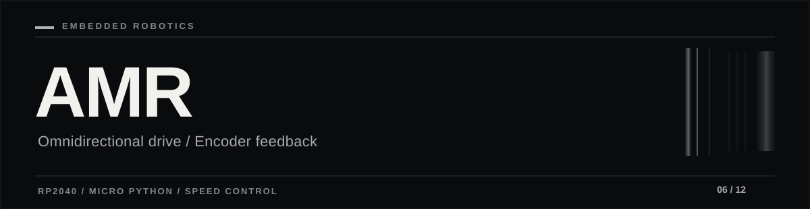
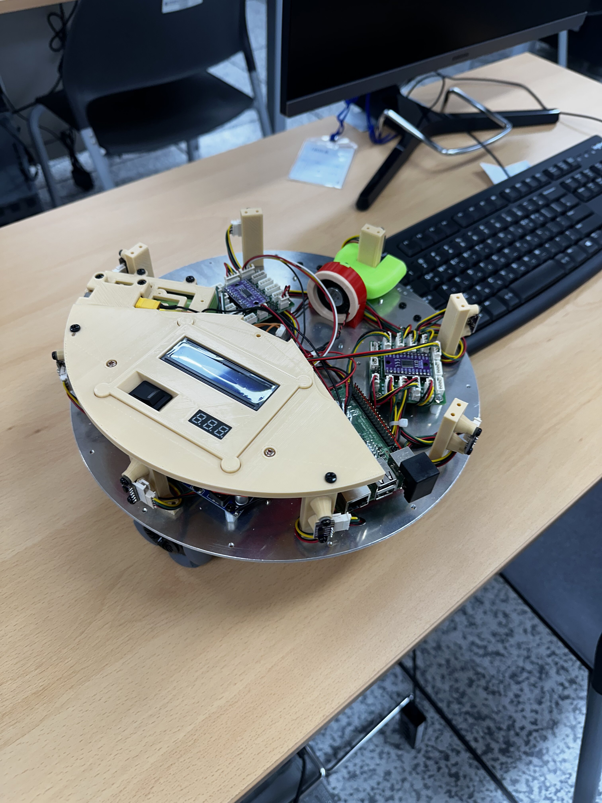
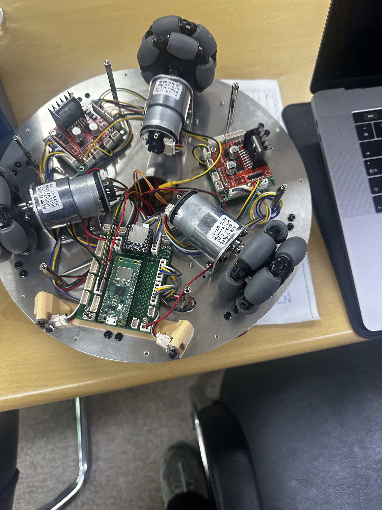

<picture>
  <source media="(max-width: 600px)" srcset="assets/portfolio-banner-mobile.svg">
  
</picture>

<a href="README.md">한국어</a> / <strong>English</strong>

# AMR — Pico Omnidirectional Speed Control

**Robotics progression 02 / 03 · Raspberry Pi Pico · MicroPython · Encoders · P Control**

Building on the AVR sensor-and-motion experiments in MRP3MV4, this project asked: **can we implement the motor-speed feedback loop ourselves?** Pico reads encoder signals and adjusts each wheel’s output toward the target RPM.

## Implemented control logic

- Encoder-based per-wheel RPM estimation
- Proportional speed control using the difference between target and measured RPM
- Inverse kinematics from planar motion/rotation to three wheel speeds
- Speed-control demonstration; accurate positioning and odometry remain out of scope

## Actual robot footage

<strong>View upper and lower robot photographs</strong>

**Next:** Encoder and motor-control experience informed the later [BuddyBot](https://github.com/rasasoe/BuddyBot) integration. [Earlier AVR project](https://github.com/rasasoe/MRP3MV4)

---

## Overview

A Raspberry Pi Pico / MicroPython project implementing **speed control for a three-wheel kiwi-drive robot**. The controller estimates wheel speed from encoders and uses proportional feedback to reduce the difference between target and measured RPM.

## Core Engineering Ideas

| Component | Function |
| --- | --- |
| Motor & Encoder classes | Encapsulated motor drive and feedback calculations |
| Proportional speed controller | Adjusts each wheel's actuation based on current RPM |
| Inverse kinematics | Maps desired chassis motion into wheel targets |
| OmniRobot | Higher-level command interface for coordinated drive |
| Simulator / logging | Provides exploratory tuning and CSV logging without moving real hardware |

The source is organized around `motor_controller.py`, `main.py`, and test/simulation scripts.

## Robot Configuration

- **MCU:** Raspberry Pi Pico
- **Motors:** GM37B-3322E, 12 V DC, 1:30 gear reduction
- **Driver:** L298N dual H-bridge
- **Wheel size:** approximately 60 mm omni wheels
- **Power:** nominal 12 V source

## Proportional Gain Tuning

Start with the robot safely lifted off the ground at low speed. Increase gain gradually while monitoring measured versus target speed. A small gain may respond weakly, while an excessive gain may oscillate.

## Current limitations

The implementation is primarily a **wheel-speed controller**. It does not by itself establish precise traveled distances, robust odometry, or production-grade localization. Those require additional wheel-state integration and real-world validation.

**[한국어 전체 README](README.md)** includes the pin map, drive equations, examples, simulator setup, and hardware operating precautions.

## Engineering progression

[MRP3MV4](https://github.com/rasasoe/MRP3MV4) → **AMR** → [BuddyBot](https://github.com/rasasoe/BuddyBot)

---

*AMR · MicroPython / Encoder Feedback / Robotics*
