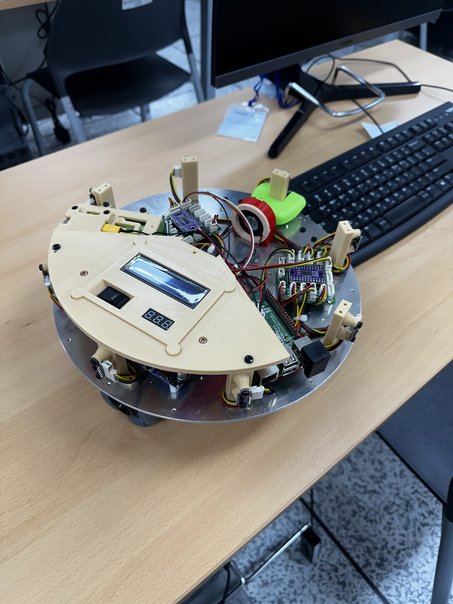
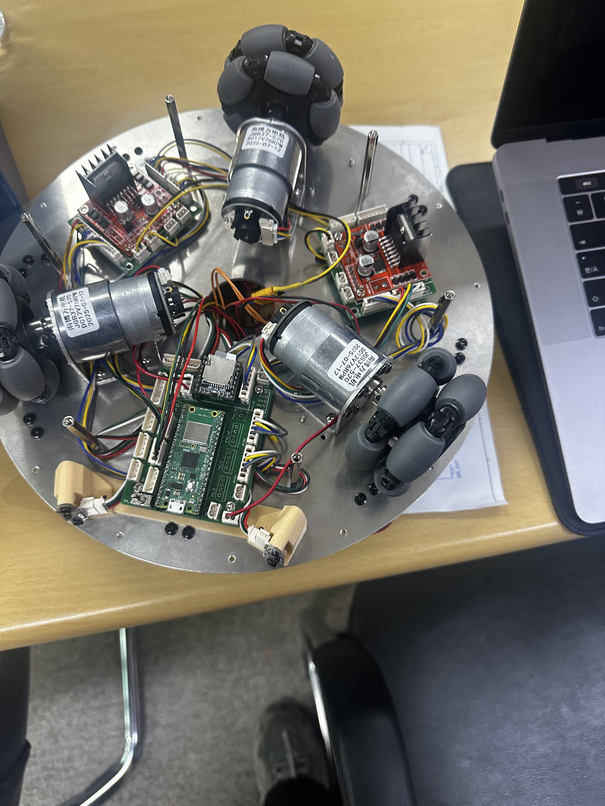

# AMR — Three-Wheel Omni Robot Speed Control

  
<a href="README.md">🇰🇷 한국어</a> · <strong>🇺🇸 English</strong>

<table><tr>
<td width="50%" align="center"><strong>Top view</strong> </td>
<td width="50%" align="center"><strong>Bottom view</strong> </td>
</tr></table>

## Overview

A Raspberry Pi Pico / MicroPython project implementing **speed control for a three-wheel kiwi-drive robot**. The controller estimates wheel speed from encoders and uses proportional feedback to reduce the difference between target and measured RPM.

## Core Engineering Ideas

| Component | Function |
| --- | --- |
| Motor & Encoder classes | Encapsulated motor drive and feedback calculations |
| Proportional speed controller | Adjusts each wheel's actuation based on current RPM |
| Inverse kinematics | Maps desired chassis motion into wheel targets |
| OmniRobot | Higher-level command interface for coordinated drive |
| Simulator / logging | Provides exploratory tuning and CSV logging without moving real hardware |

The source is organized around `motor_controller.py`, `main.py`, and test/simulation scripts.

## Robot Configuration

- **MCU:** Raspberry Pi Pico
- **Motors:** GM37B-3322E, 12 V DC, 1:30 gear reduction
- **Driver:** L298N dual H-bridge
- **Wheel size:** approximately 60 mm omni wheels
- **Power:** nominal 12 V source

## Proportional Gain Tuning

Start with the robot safely lifted off the ground at low speed. Increase gain gradually while monitoring measured versus target speed. A small gain may respond weakly, while an excessive gain may oscillate.

## Current limitations

The implementation is primarily a **wheel-speed controller**. It does not by itself establish precise traveled distances, robust odometry, or production-grade localization. Those require additional wheel-state integration and real-world validation.

**[한국어 전체 README](README.md)** includes the pin map, drive equations, examples, simulator setup, and hardware operating precautions.

## Engineering progression

[MRP3MV4](https://github.com/rasasoe/MRP3MV4) → **AMR** → [BuddyBot](https://github.com/rasasoe/BuddyBot)

---

*AMR · MicroPython / Encoder Feedback / Robotics*
